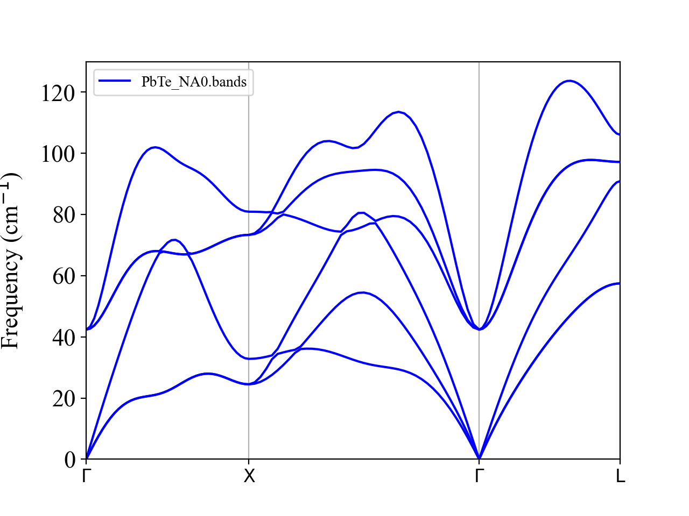
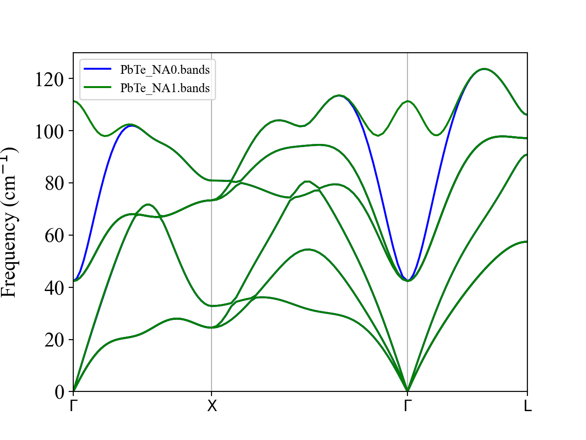

.. raw:: html

    

.. role:: red

.. _label_tutorial_pbte:

PbTe (non-analytic correction)
------------------------------

.. admonition:: At a glance
   :class: tip

   :Goal: Include the non-analytic correction in the phonon dispersion of the polar semiconductor PbTe.
   :You will learn:
      - how to let **alm** build the supercell from the primitive cell with :alm:`SUPERCELL`
      - how to create the displaced structures with ``displace.py`` from the primitive ``POSCAR``
      - how to create the :anphon:`BORNINFO` file (dielectric tensor and Born effective charges) from a DFPT calculation
      - how the :anphon:`NONANALYTIC` options 1, 2, and 3 differ
   :Prerequisites: VASP (the VASP outputs are provided in ``vasp_outputs/``) and ``PyYAML`` (used by ``displace.py``).
   :Example files: ``example/PbTe``

This part demonstrates how to include the non-analytic correction in phonon and thermal conductivity calculations of polar semiconductors.

All input files can be found at the **example/PbTe** subdirectory.
The VASP inputs are in ``vasp_inputs/``, the VASP outputs of the force calculations in ``vasp_outputs/``,
and the files generated in each step in ``reference/``, so you can skip any step by copying the corresponding file.

Let's move to the example directory

.. code-block:: console

  $ cd ${ALAMODE_ROOT}/example/PbTe

.. _tutorial_PbTe_step1:

1. Build a supercell and generate displacements
~~~~~~~~~~~~~~~~~~~~~~~~~~~~~~~~~~~~~~~~~~~~~~~

In this tutorial, we build a 4x4x4 supercell of the primitive cell of PbTe containing 2 atoms.
The crystal structure of the primitive cell in the VASP POSCAR format is

.. literalinclude:: ../../../example/PbTe/vasp_inputs/POSCAR

:download:`Download POSCAR <../../../example/PbTe/vasp_inputs/POSCAR>`

The lattice constant :math:`a = 6.4431` Å was obtained by relaxing the primitive cell with the PBEsol functional
(``INCAR.relax`` and ``KPOINTS.relax`` in ``vasp_inputs/``; the relaxation was run twice, the second time starting from the ``CONTCAR`` of the first, which left a residual stress of 0.003 kB).
This step is optional here, since the relaxed ``POSCAR`` is provided, but for your own material, please relax the primitive cell first with the same DFT settings as the force calculations:
phonon frequencies of polar materials are sensitive to the lattice constant.

Copy the primitive cell to the working directory

.. code-block:: console

    $ cp vasp_inputs/POSCAR .

We do not need to build the supercell ourselves. **alm** builds it from the input structure with the :alm:`SUPERCELL` tag.
The input for **alm** (``ALM0.in``) is

.. literalinclude:: ../../../example/PbTe/ALM0.in

:download:`Download ALM0.in <../../../example/PbTe/ALM0.in>`

Here, :alm:`STRUCTURE_FILE` reads the lattice vectors, the elements, and the atomic positions from ``POSCAR``,
so ``&cell`` and ``&position`` are not needed.
:ref:`SUPERCELL = 4 <alm_supercell>` means a 4x4x4 supercell of the input cell, :math:`(\boldsymbol{a}_s, \boldsymbol{b}_s, \boldsymbol{c}_s) = 4(\boldsymbol{a}_p, \boldsymbol{b}_p, \boldsymbol{c}_p)`, which contains 128 atoms.
Since :alm:`PRIMCELL` is not given, it takes the default value (identity matrix), and the input cell itself is used as the primitive cell.
``NORDER = 1`` and ``*-* None`` select the harmonic force constants without a cutoff radius.

Run **alm** to obtain the displacement patterns

.. code-block:: console

    $ ${ALAMODE_ROOT}/_build/alm/alm ALM0.in > ALM0.log

This finishes quickly and writes the two displacement patterns to ``pbte444.pattern_HARMONIC``.
Then, create the displaced structures with ``displace.py``

.. code-block:: console

    $ python ${ALAMODE_ROOT}/tools/displace.py --VASP POSCAR --mag 0.01 --prefix harm -pf pbte444.pattern_HARMONIC

Note that the primitive ``POSCAR`` is given, not a supercell.
``displace.py`` reads the supercell built by **alm** from the header of the pattern file, so it needs ``PyYAML``.
It generates two displaced supercells (``harm1.POSCAR`` and ``harm2.POSCAR``) with a displacement of 0.01 Å,
together with the supercell without displacements (``SPOSCAR0``), which is used as the reference structure in the next step.

.. _tutorial_PbTe_step2:

2. Run DFT calculations and get forces
~~~~~~~~~~~~~~~~~~~~~~~~~~~~~~~~~~~~~~

Next, please perform DFT calculation and compute forces for the two displaced configurations.
The ``INCAR`` and ``KPOINTS.super`` (a :math:`2\times 2\times 2` :math:`\Gamma`-centered mesh for the supercell) are in ``vasp_inputs/``.
The calculations can be done, for example, as

.. code-block:: bash

    #!/bin/bash

    cp vasp_inputs/INCAR INCAR
    cp vasp_inputs/KPOINTS.super KPOINTS
    for ((i=1;i<=2;i++))
    do
        cp harm${i}.POSCAR POSCAR
        mpirun vasp_std
        mv OUTCAR OUTCAR.${i}
        mv vasprun.xml vasprun_${i}.xml
    done
    cp vasp_inputs/POSCAR POSCAR

Here, the last line restores the primitive ``POSCAR``, which is used by **alm** in the next step.
When all calculations are done, please collect the displacement-force datasets as

.. code-block:: console

    $ python ${ALAMODE_ROOT}/tools/extract.py --VASP SPOSCAR0 vasprun_?.xml > DFSET_harmonic

The reference structure must be ``SPOSCAR0``, not the primitive ``POSCAR``:
``extract.py`` computes the displacements by comparing the atomic positions in ``vasprun_?.xml`` with those in the reference structure atom by atom,
so the reference must be the undisplaced supercell with the same atom order as the supercell built by **alm**.

In this tutorial, we have placed the VASP outputs in ``vasp_outputs/`` directory, so you can skip the VASP calculations by using the ``vasprun_?.xml`` files in that directory as

.. code-block:: console

    $ python ${ALAMODE_ROOT}/tools/extract.py --VASP SPOSCAR0 vasp_outputs/vasprun_?.xml > DFSET_harmonic

``reference/SPOSCAR0`` and ``reference/DFSET_harmonic`` are also provided.

.. _tutorial_PbTe_step3:

3. Fit second-order force constants
~~~~~~~~~~~~~~~~~~~~~~~~~~~~~~~~~~~

The input for the fitting (``ALM1.in``) is the same as ``ALM0.in`` except for ``MODE = optimize`` and the ``&optimize`` field.

.. literalinclude:: ../../../example/PbTe/ALM1.in

:download:`Download ALM1.in <../../../example/PbTe/ALM1.in>`

Please run

.. code-block:: console

    $ ${ALAMODE_ROOT}/_build/alm/alm ALM1.in > ALM1.log

and check if the fitting error in the log file (``ALM1.log``) is reasonably small (1.24% in ``reference/ALM1.log``).
The second-order force constants are saved in ``pbte444.h5``, which also stores the crystal structure and is used by **anphon** below.
A pre-generated ``pbte444.h5`` is provided in ``reference/``.

.. _tutorial_PbTe_step4:

4. Compute dielectric tensor and Born effective charges
~~~~~~~~~~~~~~~~~~~~~~~~~~~~~~~~~~~~~~~~~~~~~~~~~~~~~~~

To include the non-analytic correction, one needs to give the electronic permittivity tensor (:math:`\epsilon_{\infty}`) and the Born effective charges.
This can be done conveniently using density functional perturbation theory (DFPT), which is available in major DFT codes (e.g., VASP, Quantum-ESPRESSO, abinit).

In VASP, for example, you just need to add `LEPSILON = .True. <https://www.vasp.at/wiki/index.php/LEPSILON>`_ in INCAR. For orbital dependent functionals, this option is not supported, and `LCALCEPS = .True. <https://www.vasp.at/wiki/index.php/LCALCEPS>`_ should be used instead.
The inputs used for this tutorial are ``INCAR.dfpt`` and ``KPOINTS.dfpt`` (a :math:`20\times 20\times 20` :math:`\Gamma`-centered mesh) in ``vasp_inputs/``, together with the primitive ``POSCAR``.

.. literalinclude:: ../../../example/PbTe/vasp_inputs/INCAR.dfpt

.. important::

    Please run a DFPT calculation using the same primitive cell (``POSCAR``) that you gave to **alm** to generate the supercell. If these two structures are inconsistent, the order of the atoms and Born effective charges may change, which likely results in strange phonon band dispersion.

Once the DFPT calculation finishes, please parse the electronic permittivity tensor and Born effective charges from the output file and save them in a single file following the specific format described in :ref:`label_format_BORNINFO`.

If you used VASP, the :anphon:`BORNINFO` file can be created by issuing

.. code-block:: console

    $ python ${ALAMODE_ROOT}/tools/extract.py --VASP POSCAR --get born vasprun.xml > PbTe.born

Here, ``POSCAR`` is the primitive cell used in the DFPT calculation, and ``vasprun.xml`` is the output of the DFPT calculation.
This parsing feature is supported only for VASP and Quantum-ESPRESSO.

We provide the pre-generated file ``PbTe.born`` in the ``reference/`` directory, so you can copy it to the working directory to move forward.
It gives :math:`\epsilon_{\infty} = 30.40` and :math:`Z^{*}_{\mathrm{Pb}} = -Z^{*}_{\mathrm{Te}} = 5.88`.
The Born effective charge changes by about 0.6% from a :math:`12\times 12\times 12` to the :math:`20\times 20\times 20` mesh, so please check the :math:`k`-point convergence for your own system.

.. _tutorial_PbTe_step5:

5. Phonon calculations
~~~~~~~~~~~~~~~~~~~~~~

All inputs are ready, so we can start phonon calculations. 

We first compute phonon dispersion without non-analytic (NA) correction. 
The input file for **anphon** (``phband.in``) looks like

.. literalinclude:: ../../../example/PbTe/reference/phband.in

:download:`Download phband.in <../../../example/PbTe/reference/phband.in>`

The crystal structure is read from ``pbte444.h5``, so ``&cell`` and :anphon:`KD` are not needed.
Copy it to the working directory (if you skipped the previous steps, copy ``reference/pbte444.h5`` and ``reference/PbTe.born`` as well).

Please run **anphon** and plot the bands file

.. code-block:: console

    $ cp reference/phband.in .
    $ ${ALAMODE_ROOT}/_build/anphon/anphon phband.in > phband.log
    $ python ${ALAMODE_ROOT}/tools/plotband.py PbTe_NA0.bands

We can see that the TO and LO phonons are degenerate at :math:`\boldsymbol{q}=0` and the optical phonon frequencies go down rapidly as :math:`\boldsymbol{q}\longrightarrow 0`. All three optical modes are at 42.4 cm\ :sup:`-1` at :math:`\Gamma`.

Next, let us consider the NA correction. 
Please change the :anphon:`PREFIX` and :anphon:`NONANALYTIC` tags as 

.. code-block:: 

    PREFIX = PbTe_NA1
    NONANALYTIC = 1; NA_SIGMA = 0.15

This option activates Parlinski's approach with the damping factor of :math:`\sigma = 0.15`.
After running **anphon** again, we can compare phonon dispersion curves with and without the NA correction.

.. code-block:: console

    $ ${ALAMODE_ROOT}/_build/anphon/anphon phband.in > phband.log2
    $ python ${ALAMODE_ROOT}/tools/plotband.py PbTe_NA0.bands PbTe_NA1.bands

The LO-TO splitting occurs as expected: the LO frequency at :math:`\Gamma` is now 111.3 cm\ :sup:`-1`, while the TO frequency stays at 42.4 cm\ :sup:`-1`.

Please repeat the above calculations with the other :anphon:`NONANALYTIC` options (``NONANALYTIC=2`` (mixed-space) and ``NONANALYTIC=3`` (Ewald method)).
Finally, we plot all results together to see the difference.

.. code-block:: console

    $ python ${ALAMODE_ROOT}/tools/plotband.py PbTe_NA?.bands

.. interactive-plot::
   :kind: dispersion-compare
   :data: ../../../example/PbTe/reference/PbTe_NA0.bands ../../../example/PbTe/reference/PbTe_NA1.bands
          ../../../example/PbTe/reference/PbTe_NA2.bands ../../../example/PbTe/reference/PbTe_NA3.bands
   :labels: NONANALYTIC = 0; NONANALYTIC = 1; NONANALYTIC = 2; NONANALYTIC = 3
   :fallback: ../../img/PbTe_harm_compare.png
   :scale: 40
   :align: center

We can see that ``NONANALYTIC = 2`` and ``NONANALYTIC = 3`` give smoother dispersion than ``NONANALYTIC = 1``. 
For these two methods,the NA correction becomes exactly zero at the commensurate :math:`\boldsymbol{q}` points (other than :math:`\boldsymbol{q}\longrightarrow 0`). In the present calculation, we used a 4x4x4 supercell of the primitive cell. Hence, the NA correction should be zero at the Brillouin zone boundaries (X and L points) as well as the midpoint of each high-symmetry line (e.g., :math:`\boldsymbol{q}=(1/4, 1/4, 0)`). We can confirm this from the above figure, where the blue, red, and magenta curves perfectly intersect with each other at these commensurate points. The ``NONANALYTIC = 1`` result (green) instead shows unphysical dips of the LO branch between :math:`\Gamma` and the zone boundaries, which are an artifact of this approach.

In general, we recommend using ``NONANALYTIC = 3`` as it correctly separates the short- and long-range terms and calculates the NA correction in the reciprocal space accurately using the Ewald summation method. It can also avoid abrupt jumps or discontinuities in dispersion curves at Brillouin zone boundaries, which can happen with ``NONANALYTIC = 2`` when the BZ boundary is not commensurate with the supercell size.