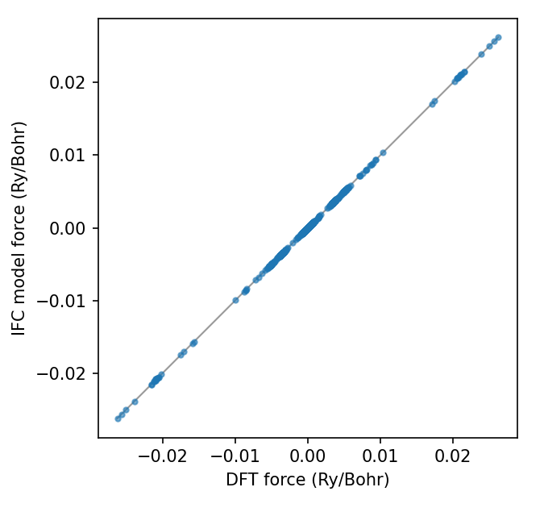
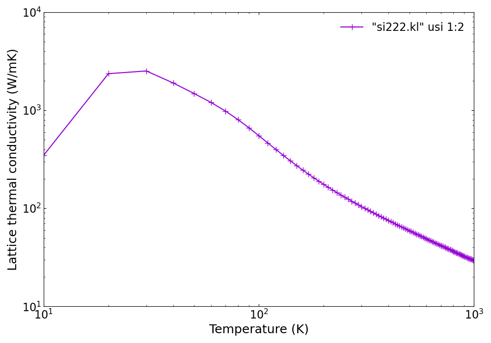

.. |Angstrom|   unicode:: U+00C5

.. raw:: html

    

.. role:: red

.. _label_tutorial_01:

Silicon
-------

.. admonition:: At a glance
   :class: tip

   :Goal: Calculate phonon dispersion, phonon DOS, and lattice thermal conductivity of bulk Si from DFT forces.
   :You will learn:
      - how to generate displacement patterns with **alm** and collect forces with ``displace.py`` and ``extract.py``
      - how to fit harmonic and cubic IFCs by least squares
      - how to calculate phonon dispersion, DOS, and thermal conductivity with **anphon**
      - how to analyze phonon lifetimes, cumulative and spectral thermal conductivity
   :Prerequisites: ALAMODE (**alm** and **anphon**) and a DFT code (QE, VASP, xTAPP, or OpenMX). The reference DFSET files let you skip the DFT calculations.
   :Example files: ``example/Si``

.. structure-viewer::
   :structure: ../../../example/Si/reference/si_alm1.in
   :fallback: ../../img/si222.png
   :scale: 40%
   :align: center

   Silicon. 2x2x2 conventional supercell

In the following, (anharmonic) phonon properties of bulk silicon (Si) are calculated by a 2x2x2 conventional cell containing 64 atoms. 

#. :ref:`Get displacement pattern by alm <tutorial_Si_step1>`
#. :ref:`Calculate atomic forces for the displaced configurations <tutorial_Si_step2>`
#. :ref:`Estimate force constants by fitting <tutorial_Si_step3>`
#. :ref:`Calculate phonon dispersion and phonon DOS <tutorial_Si_step4>`
#. :ref:`Estimate anharmonic IFCs for thermal conductivity <tutorial_Si_step5>`
#. :ref:`Calculate thermal conductivity <tutorial_Si_step6>`
#. :ref:`Analyze results <tutorial_Si_step7>`

.. _tutorial_Si_step1:

1. Get displacement patterns by **alm**
~~~~~~~~~~~~~~~~~~~~~~~~~~~~~~~~~~~~~~~~

Copy :red:`example/Si/reference/si_alm1.in` to :red:`si_alm.in` in a new working directory, and open it.
(The :red:`si_alm.in` shipped in **example/Si** is the finished input of :ref:`step 3 <tutorial_Si_step3>`,
which you can use for comparison.)
This file is an input for the code **alm**, which estimates interatomic force constants (**IFC**) by least-squares fitting.
In the file, the crystal structure of a 2x2x2 conventional supercell of Si is specified in the **&cell** and the **&position** fields as the following:

.. literalinclude:: ../../../example/Si/reference/si_alm1.in
   :lines: 1-30

:download:`Download si_alm1.in <../../../example/Si/reference/si_alm1.in>`

Replace the lattice constant of the supercell (20.406 Bohr) by your own value.

Then, execute **alm**
::

  $ alm si_alm.in > si_alm.log1

which creates a file :red:`si222.pattern_HARMONIC` in the working directory. 
In the pattern file, suggested displacement patterns are defined in Cartesian coordinates. 
As you can see in the file, there is only one displacement pattern for harmonic IFCs of bulk Si.

.. _tutorial_Si_step2:

2. Calculate atomic forces for the displaced configurations
~~~~~~~~~~~~~~~~~~~~~~~~~~~~~~~~~~~~~~~~~~~~~~~~~~~~~~~~~~~~

Next, calculate atomic forces for all the displaced configurations defined in :red:`si222.pattern_HARMONIC`.
To do so, you first need to decide the magnitude of displacements :math:`\Delta u`, which should be small so that anharmonic contributions are negligible. In most cases, :math:`\Delta u \sim 0.01` |Angstrom| is a reasonable choice. 

Then, prepare input files necessary to run an external DFT code for each configuration.
Since this procedure is a little tiresome, we provide a subsidiary Python script for VASP, Quantum-ESPRESSO (QE), xTAPP, OpenMX, and LAMMPS.
Using the script :red:`displace.py` in the tools/ directory, you can generate the necessary input files as follows:

.. tab-set::
   :sync-group: dftcode

   .. tab-item:: QE
      :sync: qe

      .. code-block:: console

         $ python displace.py --QE=si222.pw.in --mag=0.01 -pf si222.pattern_HARMONIC

   .. tab-item:: VASP
      :sync: vasp

      .. code-block:: console

         $ python displace.py --VASP=POSCAR.orig --mag=0.01 -pf si222.pattern_HARMONIC

   .. tab-item:: xTAPP
      :sync: xtapp

      .. code-block:: console

         $ python displace.py --xTAPP=si222.cg --mag=0.01 -pf si222.pattern_HARMONIC

   .. tab-item:: OpenMX
      :sync: openmx

      .. code-block:: console

         $ python displace.py --OpenMX=si222.dat --mag=0.01 -pf si222.pattern_HARMONIC

The ``--mag`` option specifies the displacement length in units of Angstrom. 
You need to specify an input file with equilibrium atomic positions either by the ``--QE``, ``--VASP``, ``--xTAPP``, ``--OpenMX`` or ``--LAMMPS``.

Then, calculate atomic forces for all the configurations. This can be done with a simple shell script 
as follows::

    #!/bin/bash

    # Assume we have 20 displaced configurations for QE [disp01.pw.in,..., disp20.pw.in].

    for ((i=1;i<=20;i++))
    do
        num=`echo $i | awk '{printf("%02d",$1)}'`
        mkdir ${num}
        cd ${num}
        cp ../disp${num}.pw.in .
        pw.x < disp${num}.pw.in > disp${num}.pw.out
        cd ../
    done

.. important::
   In QE, you need to set tprnfor=.true. to print out atomic forces. 

The next step is to collect the displacement data and force data by the Python script :red:`extract.py` (also in the tools/ directory). This script can extract atomic displacements, atomic forces, and total energies from multiple output files as follows:

.. tab-set::
   :sync-group: dftcode

   .. tab-item:: QE
      :sync: qe

      .. code-block:: console

         $ python extract.py --QE=si222.pw.in *.pw.out > DFSET_harmonic

   .. tab-item:: VASP
      :sync: vasp

      .. code-block:: console

         $ python extract.py --VASP=POSCAR.orig vasprun*.xml > DFSET_harmonic

   .. tab-item:: xTAPP
      :sync: xtapp

      .. code-block:: console

         $ python extract.py --xTAPP=si222.cg *.str > DFSET_harmonic

   .. tab-item:: OpenMX
      :sync: openmx

      .. code-block:: console

         $ python extract.py --OpenMX=si222.dat *.out > DFSET_harmonic

In the above examples, atomic displacements and corresponding atomic forces of all the configurations are merged as :red:`DFSET_harmonic`. 
These files will be used in the following fitting procedure as :alm:`DFSET` (See :ref:`Format of DFSET <label_format_DFSET>`).

.. Note::
   For your convenience, we provide the :red:`DFSET_harmonic` file in the reference/ subdirectory. This file is generated by the Quantum-ESPRESSO package with ``--mag=0.01``. You can proceed to the next step by copying this file to the working directory.

.. _tutorial_Si_step3:

3. Estimate force constants by fitting
~~~~~~~~~~~~~~~~~~~~~~~~~~~~~~~~~~~~~~~

Edit the file :red:`si_alm.in` to perform least-squares fitting.
Change the ``MODE = suggest`` to ``MODE = optimize`` as follows::

    &general
      PREFIX = si222
      MODE = optimize   # <-- here
      KD = Si
      PRIMCELL = A
    /

Also, add the **&optimize** field as::

    &optimize
      DFSET = DFSET_harmonic
    /

Then, execute **alm** again
::

    $ alm si_alm.in > si_alm.log2

This time **alm** extracts harmonic IFCs from the given displacement-force data set (``DFSET_harmonic``).

You can find the file :red:`si222.h5` in the working directory, which contains crystal structure, symmetry, IFCs,
and all other information necessary for subsequent phonon calculations.
If you also want to inspect the IFCs, add ``FCS_ALAMODE = 1`` to the **&general** field: **alm** then writes the
human-readable listing :red:`si222.fcs` (and the legacy :red:`si222.xml`) as well.
The file :red:`si222.fcs` contains all IFCs in Rydberg atomic units, and
you can find symmetrically irreducible sets of IFCs in the first part as:

.. dropdown:: si222.fcs (first 40 lines)

   .. literalinclude:: ../../../example/Si/reference/si222.fcs
      :lines: 1-40

Harmonic IFCs :math:`\Phi_{\mu\nu}(i,j)` in the supercell are given in the third column
and the multiplicity :math:`P` is the number of times each interaction :math:`(i, j)` occurs within the given cutoff radius.
For example, :math:`P = 2` for the pair :math:`(1x, 2x)` because the distance :math:`r_{1,2}` is exactly the same as the distance :math:`r_{1,2'}` where the atom 2' is a neighboring image of atom 2 under the periodic boundary condition.
If you compare the magnitude of IFCs, the values in the third column should be divided by :math:`P`.

In the log file :red:`si_alm.log2`, the :ref:`fitting error<fitting_formalism>` is printed.
Try
::

  $ grep "Fitting error" si_alm.log2
  Fitting error (%) : 0.567

The file :red:`si222.h5` is the one that **anphon** reads in the following steps.
To check its content without writing the text files, use the Python script :red:`fcsinfo.py` in the tools/ directory
(h5py is required.)::

  $ python fcsinfo.py si222.h5

It prints the input variables of the **alm** run, the primitive cell and the supercell, and,
for each order, the number of IFCs, the largest value, the longest interaction distance, and, for harmonic IFCs,
the residual of the acoustic sum rule:

.. code-block:: none

   [PrimitiveCell]  2 atoms, volume 265.536159 bohr^3
     a1 =     0.00000000     5.10150000     5.10150000  (bohr)
     a2 =     5.10150000     0.00000000     5.10150000  (bohr)
     a3 =     5.10150000     5.10150000     0.00000000  (bohr)
     composition: Si2
     ...
   [ForceConstants]
     Order2: 1386 entries [Ry/bohr^2], max|Phi| 2.761355e-01, max distance 17.672114 bohr
       ASR residual max|sum_j Phi(i,j)| = 2.932e-16

``--order 2`` also lists the individual entries, and ``--verbose`` prints everything.

.. _tutorial_Si_step4:

4. Calculate phonon dispersion and phonon DOS
~~~~~~~~~~~~~~~~~~~~~~~~~~~~~~~~~~~~~~~~~~~~~~

Open the file :red:`si_phband.in` and edit it for your system.

.. literalinclude:: ../../../example/Si/reference/si_phband.in

:download:`Download si_phband.in <../../../example/Si/reference/si_phband.in>`

Please specify the force-constant file you obtained in step 3 with the :anphon:`FCSFILE`-tag as above.
No **&cell**-field is needed: because of ``PRIMCELL = A`` in the **alm** input, :red:`si222.h5` stores the primitive cell,
and **anphon** works in that cell.
Without :alm:`PRIMCELL`, the file stores the 64-atom supercell, and the lattice vectors of the primitive cell must then be given
in the **&cell**-field (see :ref:`&cell-field <anphon_cell_field>`).
The element names are also read from the force-constant file, and the atomic masses are taken from the standard atomic weights unless :anphon:`MASS` is given.
In phonon dispersion calculations, the first entry in the **&kpoint**-field should be 1 (**KPMODE** = 1).

Then, execute **anphon**
::
    
    $ anphon si_phband.in > si_phband.log

which creates a file :red:`si222.bands` in the working directory.
In this file, phonon frequencies along the given reciprocal path are printed in units of cm\ :sup:`-1` as:

.. literalinclude:: ../../../example/Si/reference/si222.bands
   :lines: 1-10

You can plot the phonon dispersion relation with gnuplot or any other plot software.

For visualizing phonon dispersion relations, we provide a Python script :red:`plotband.py` in the tools/ directory 
(Matplotlib is required.). Try
::  
    
    $ python plotband.py si222.bands

Then, the phonon dispersion is displayed as follows:

.. interactive-plot::
   :kind: dispersion
   :data: ../../../example/Si/reference/si222.bands
   :labels: si222.bands
   :fallback: ../../img/Si_phband_DFT.png
   :scale: 30
   :align: center

You can save the figure as png, eps, or other formats from this window.
You can also change the energy unit of phonon frequency from cm\ :sup:`-1` to THz or meV by the ``--unit`` option. 
For more detail of the usage of :red:`plotband.py`, type
::

   $ python plotband.py -h

Next, let us calculate the phonon DOS. Copy :red:`si_phband.in` to :red:`si_phdos.in` and edit the **&kpoint** field as follows::

    &kpoint
      2  # KPMODE = 2: uniform mesh mode
      20 20 20
    /

Then, execute **anphon**
::
    
    $ anphon si_phdos.in > si_phdos.log

This time, **anphon** creates files :red:`si222.dos` and :red:`si222.thermo` in the working directory, 
which contain phonon DOS and thermodynamic functions, respectively.
For visualizing phonon DOS and projected DOSs, we provide a Python script :red:`plotdos.py` in the tools/ directory (Matplotlib is required.).
The command 
::

    $ python plotdos.py --emax 550 --nokey si222.dos

will show the phonon DOS of Si by a pop-up window:

.. interactive-plot::
   :kind: dispersion
   :data: ../../../example/Si/reference/si222.bands
   :dos: ../../../example/Si/reference/si222_20.dos.bz2
   :fallback: ../../img/Si_phdos_DFT.png
   :scale: 30
   :align: center

.. only:: html

   The interactive figure above shows the DOS next to the phonon dispersion;
   ``plotdos.py`` plots the DOS alone, with the frequency on the horizontal axis.

To improve the resolution of DOS, try again with a denser :math:`k` grid and a smaller :anphon:`DELTA_E` value.

.. _tutorial_Si_step5:

5. Estimate cubic IFCs for thermal conductivity
~~~~~~~~~~~~~~~~~~~~~~~~~~~~~~~~~~~~~~~~~~~~~~~

.. note::
    Note that there are more efficient ways to calculate anharmonic IFCs, especially when 
    you calculate the quartic or higher-order terms.
    Please see :ref:`label_tutorial_bto_ifc` and :ref:`label_tutorial_silicon_ifc` for details.

Copy file :red:`si_alm.in` to :red:`si_alm2.in`. 
Edit the **&general**, **&interaction**, and **&cutoff** fields of :red:`si_alm2.in` as the following::

    &general
      PREFIX = si222_cubic
      MODE = suggest
      KD = Si
      PRIMCELL = A
    /

Change the :alm:`PREFIX` from *si222* to *si222_cubic* and set :alm:`MODE` to *suggest*.

::

    &interaction
      NORDER = 2
    /

Change the :alm:`NORDER` tag from ``NORDER = 1`` to ``NORDER = 2`` to include cubic IFCs. 
Here, we consider cubic interaction pairs up to second nearest neighbors by specifying the cutoff radii as::

    &cutoff
      Si-Si None 7.3
    /

7.3 Bohr is slightly larger than the distance of second nearest neighbors (7.21461 Bohr). 
Change the cutoff value appropriately for your own case. (Atomic distances can be found in the file :red:`si_alm.log1`.)

Then, execute **alm**
::

    $ alm si_alm2.in > si_alm2.log

which creates files si222_cubic.pattern_HARMONIC and :red:`si222_cubic.pattern_ANHARM3`.

Then, calculate atomic forces of displaced configurations given in the file :red:`si222_cubic.pattern_ANHARM3`, and collect the displacement and force datasets to a file :red:`DFSET_cubic` as you did for harmonic IFCs in Step 2.

.. Note::
    Since making :red:`DFSET_cubic` requires moderate computational resources, you can skip this procedure by copying file :red:`reference/DFSET_cubic` to the working directory. The file we provide is generated by the Quantum-ESPRESSO package with ``--mag=0.04``.

In :red:`si_alm2.in`, change ``MODE = suggest`` to ``MODE = optimize`` and add the following::

    &optimize
      DFSET = DFSET_cubic
      FC2FIX = si222.h5 # Fix harmonic IFCs
    /

By the :alm:`FC2FIX` tag, harmonic IFCs are fixed to the values in :red:`si222.h5`.
Then, execute **alm** again
::

    $ alm si_alm2.in > si_alm2.log2

which creates the file :red:`si222_cubic.h5`. This time cubic IFCs are also included in the file.

.. Note::
    In the above example, we obtained cubic IFCs by least-squares fitting with harmonic IFCs being fixed to the value of the previous harmonic calculation. You can also estimate both harmonic and cubic IFCs simultaneously instead. To do this, merge :red:`DFSET_harmonic` and :red:`DFSET_cubic` as
    ::

        $ cat DFSET_harmonic DFSET_cubic > DFSET_merged

    and change the **&optimize** field as the following::

        &optimize
          DFSET = DFSET_merged
        /

The Python script :red:`calcpes.py` in the tools/ directory (ASE is required.) evaluates the Taylor-expansion
potential defined by the IFCs, which is a quick way to see what the cubic terms do.
For example, move atom 1 along [111], toward one of its nearest neighbors, from :math:`-0.3` to :math:`0.3` Bohr.
The displacement file lists the displacements (in Bohr) of all 64 atoms for each structure, one atom per line::

    $ python -c "
    import numpy as np, sys
    for u in np.linspace(-0.3, 0.3, 7):
        d = np.zeros((64, 3)); d[0] = u / np.sqrt(3)
        np.savetxt(sys.stdout, d)" > disp111.dat
    $ python calcpes.py --fcs si222_cubic.h5 --disp disp111.dat --unit eV
    # potential energies (eV)
    #           total              fc2              fc3
       1.42949818e-01   1.68940899e-01  -2.59910812e-02
       6.73837830e-02   7.50848441e-02  -7.70106110e-03
       1.78085784e-02   1.87712110e-02  -9.62632637e-04
       0.00000000e+00   0.00000000e+00   0.00000000e+00
       1.97338437e-02   1.87712110e-02   9.62632637e-04
       8.27859052e-02   7.50848441e-02   7.70106110e-03
       1.94931980e-01   1.68940899e-01   2.59910812e-02

The harmonic energy (``fc2``) is symmetric in :math:`u`, while the cubic term (``fc3``) changes sign,
so pushing the atom into the bond (:math:`u > 0`) costs more energy than pulling it away.
(With ``--print-forces``, the script prints the atomic forces instead.)

The same script checks how well the IFCs reproduce the DFT data.
With ``--dfset``, it reads the displacements and the DFT forces from a ``DFSET`` file
(in Bohr and Ry/Bohr) and compares them with the forces of the Taylor expansion;
``--plot`` saves a parity plot::

    $ python calcpes.py --fcs si222_cubic.h5 --dfset DFSET_cubic --plot parity.png
    # DFSET_cubic: 20 snapshots of 64 atoms
    # force error |F_model - F_DFT| / |F_DFT| = 0.1206 %, RMS 3.1199e-06 Ry/Bohr
    #  snapshot  force error (%)
              1           0.0527
              2           0.3099
    ...

   Forces of the harmonic + cubic IFC model against the DFT forces of :red:`DFSET_cubic`

The relative force error is the fitting error printed in :red:`si_alm2.log2`.
With ``--maxorder 2`` only the harmonic IFCs are used, and the error grows to 3.25%: this is the part of the forces
that the cubic IFCs account for.
If the ``DFSET`` file has ``E_pot`` lines, as written by :red:`extract.py`, the energies are compared as well.
Because the energy of the undisplaced supercell is not in the file, it is fitted, unless you give it by ``--e0`` (in eV).
In all cases, the supercell is taken from the IFC file; give ``--structure`` to use another file readable by ASE.

.. _tutorial_Si_step6:

6. Calculate thermal conductivity
~~~~~~~~~~~~~~~~~~~~~~~~~~~~~~~~~~

Copy file :red:`si_phdos.in` to :red:`si_RTA.in` and edit the :anphon:`MODE` and :anphon:`FCSFILE` tags as follows::

    &general
      PREFIX = si222
      MODE = kappa
      FCSFILE = si222_cubic.h5
    /

In addition, change the :math:`k` grid density as::

    &kpoint
      2
      10 10 10
    /

Then, execute **anphon** as a background job
::

    $ anphon si_RTA.in > si_RTA.log &

When the job finishes, you can find a file :red:`si222.kl` in which the lattice thermal conductivity is saved.
You can plot this file using gnuplot (or any other plotting software) as follows::

    $ gnuplot
    gnuplot> set logscale xy
    gnuplot> set xlabel "Temperature (K)"
    gnuplot> set ylabel "Lattice thermal conductivity (W/mK)"
    gnuplot> plot "si222.kl" usi 1:2 w lp

   Calculated lattice thermal conductivity of Si (click to enlarge)

As you can see, the thermal conductivity has a peak at low temperature. Below the peak, the thermal
conductivity is limited by the phonon-isotope scattering, which is included by default (``ISOTOPE = 1``).
The phonon-boundary scattering, which becomes dominant in the low-temperature range, is not included in the
present calculation. The effect of the boundary scattering can be included using the python script ``analyzer.py`` in the tools directory::

    $ analyzer.py --calc kappa --size 1.0e+6 --h5 si222.kappa.h5 > si222_boundary_1mm.kl

(``--3ph si222.result`` can be used instead of ``--h5 si222.kappa.h5`` when the calculation was run with ``FILE_FORMAT = text``.)

In this script, the phonon lifetimes are altered using the Matthiessen's rule

.. math::

  \frac{1}{\tau_{q}^{total}} = \frac{1}{\tau_{q}^{p-p}} + \frac{2|\boldsymbol{v}_{q}|}{L}.

Here, the first term on the right-hand side of the equation is the scattering rate due to 
the phonon-phonon scattering and the second term is the scattering rate due to a grain boundary of size :math:`L`.
The size :math:`L` must be specified using the ``--size`` option in units of nm. The boundary effect further
reduces the thermal conductivity in the low-temperature range.

.. Note::
    When a calculation is performed with a smearing method (``ISMEAR=0 or 1``) instead of the
    tetrahedron method (``ISMEAR=-1``), the thermal conductivity may have a peak structure in the very low-temperature region even without the boundary effect. This peak occurs because of the finite smearing width :math:`\epsilon` used in the smearing methods. As we decrease the :math:`\epsilon` value, the peak value of :math:`\kappa` should disappear. In addition, a very dense :math:`q` grid is necessary for describing phonon excitations and thermal transport in the low-temperature region (regardless of the :anphon:`ISMEAR` value).

.. _tutorial_Si_step7:

7. Analyze results
~~~~~~~~~~~~~~~~~~

There are many ways to analyze the result for a better understanding of nanoscale thermal transport.
Some selected features are introduced below:

Phonon lifetime
^^^^^^^^^^^^^^^

The file :red:`si222.kappa.h5` contains phonon frequencies, group velocities, and linewidths at irreducible :math:`k` points
(with ``FILE_FORMAT = text`` the same data are written to the text file :red:`si222.result`).
You can extract phonon lifetime from this file as follows::

    $ analyzer.py --calc tau --temp 300 --h5 si222.kappa.h5 > tau300K_10.dat
    $ gnuplot
    gnuplot> set xrange [1:]
    gnuplot> set logscale y
    gnuplot> set xlabel "Phonon frequency (cm^{-1})"
    gnuplot> set ylabel "Phonon lifetime (ps)"
    gnuplot> plot "tau300K_10.dat" using 4:6 w p

.. figure:: ../../img/si_tau.png
   :scale: 40%
   :align: center

   Phonon lifetime of Si at 300 K (click to enlarge)

In the above figure, phonon lifetimes calculated with :math:`20\times 20\times 20\ q` points are also shown by open circles. 

Cumulative thermal conductivity
^^^^^^^^^^^^^^^^^^^^^^^^^^^^^^^

Following the procedure below, you can obtain the :ref:`cumulative thermal conductivity <cumulative_kappa>`::

    $ analyzer.py --calc cumulative --temp 300 --h5 si222.kappa.h5 > cumulative_300K_10.dat
    $ gnuplot
    gnuplot> set logscale x
    gnuplot> set xlabel "L (nm)"
    gnuplot> set ylabel "Cumulative kappa (W/mK)"
    gnuplot> plot "cumulative_300K_10.dat" using 1:2 w lp

.. figure:: ../../img/si_cumulative.png
   :scale: 40%
   :align: center

   Cumulative thermal conductivity of Si at 300 K (click to enlarge)

To draw a smooth line, you have to use a denser :math:`q` grid as shown in the figure by the orange line,
which are obtained with :math:`20\times 20\times 20\ q` points.

Beyond the relaxation-time approximation
^^^^^^^^^^^^^^^^^^^^^^^^^^^^^^^^^^^^^^^^

The RTA neglects the in-scattering term of the collision operator and therefore underestimates :math:`\kappa`
of crystals in which Normal processes are important (see :ref:`this page <kappa_beyond_rta>`).
To solve the linearized Boltzmann transport equation instead, add a :anphon:`SOLVER` tag to the ``&kappa`` field of
:red:`si_RTA.in`::

    &kappa
     SOLVER = VBTE  # RTA (default), IBTE, VBTE, or DBTE
    /

and run anphon again. The converged result is saved in :red:`si222.kl_iter` with the same layout as
:red:`si222.kl`, so both can be plotted together::

    $ gnuplot
    gnuplot> set logscale xy
    gnuplot> plot "si222.kl" usi 1:2 w lp title "RTA", "si222.kl_iter" usi 1:2 w lp title "VBTE"

For silicon on this :math:`10\times 10\times 10` grid the correction is about 2% at room temperature
(:math:`\kappa` = 104.4 W/mK in the RTA and 106.9 W/mK with VBTE at 300 K; IBTE gives the same result) but exceeds
25% at 20 K and below, where Normal processes dominate. It is much larger in materials with very high thermal conductivity
such as diamond or BAs.

Thermal conductivity spectrum
^^^^^^^^^^^^^^^^^^^^^^^^^^^^^

To calculate the :ref:`spectrum of thermal conductivity <kappa>`, modify the :red:`si_RTA.in` as follows::

    &general
      PREFIX = si222
      MODE = kappa
      FCSFILE = si222_cubic.h5

      EMIN = 0; EMAX = 550; DELTA_E = 1.0 # <-- frequency range
    /

    &kpoint
     2
     10 10 10
    /

    &kappa
     KAPPA_SPEC = 1 # compute spectrum of kappa
    /

The frequency range is specified with the :anphon:`EMIN`, :anphon:`EMAX`, and :anphon:`DELTA_E` tags, and ``KAPPA_SPEC = 1`` is set in the ``&kappa`` field. Then, execute anphon again
::

    $ anphon si_RTA.in > si_RTA2.log 

After the calculation finishes, you can find the file :red:`si222.kl_spec` which contains the spectra of thermal conductivity at various temperatures. You can plot the data at room temperature as follows::
    
    $ awk '{if ($1 == 300.0) print $0}' si222.kl_spec > si222_300K_10.kl_spec
    $ gnuplot
    gnuplot> set xlabel "Frequency (cm^{-1})"
    gnuplot> set ylabel "Spectrum of kappa (W/mK/cm^{-1})"
    gnuplot> plot "si222_300K_10.kl_spec" using 2:3 w l lt 2 lw 2

.. figure:: ../../img/si_kappa_spec.png
   :scale: 40%
   :align: center

   The spectrum of thermal conductivity of Si at 300 K (click to enlarge)

In the above figure, the computational result with :math:`20\times 20\times 20\ q` points is also shown by the dashed line. 
From the figure, we can observe that low-energy phonons below 200 cm\ :math:`^{-1}` account for more than 80% of the total thermal conductivity at 300 K.
