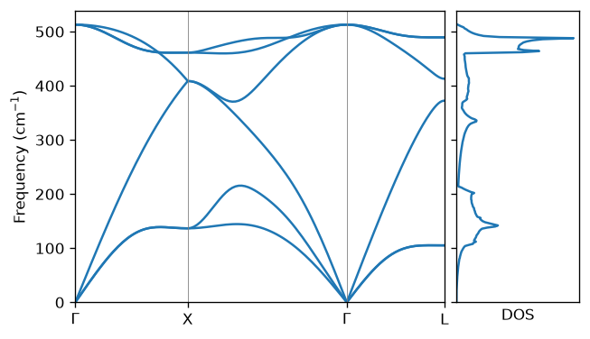

.. raw:: html

    

.. role:: red

.. _label_tutorial_si_python:

Silicon with Python
-------------------

.. admonition:: At a glance
   :class: tip

   :Goal: Run the phonon and thermal-conductivity calculations of the :ref:`Si tutorial <label_tutorial_01>`
          from a Python script, and analyze the results with NumPy and Matplotlib.
   :You will learn:
      - how to run **anphon** from Python dictionaries with ``anphon.run``
      - how to read the output files through the returned ``Result``
      - how to get frequencies and eigenvectors at arbitrary :math:`q` points with ``anphon.Phonon``
      - how to read ``PREFIX.kappa.h5`` into a dictionary with ``Result.h5``
   :Prerequisites: :ref:`The Si tutorial <label_tutorial_01>` and the ``alamode`` Python package
                   (see :ref:`anphon_python_install`), plus Matplotlib.
   :Example files: ``example/Si/python``
   :Run time: The whole script takes a few seconds.

The Python package ``anphon`` runs the same calculations as the command-line program,
inside the Python process (see :ref:`anphon_python` for the full reference).
In this tutorial, we redo the phonon dispersion, phonon DOS, and thermal conductivity of Si from
the :ref:`Si tutorial <label_tutorial_01>` with the force constants in **example/Si/reference**.
The complete script is :red:`si_python.py`:

:download:`Download si_python.py <../../../example/Si/python/si_python.py>`

It finds the force constants relative to its own location, so it can be run from any directory.
The outputs are written to the subdirectories :red:`bands`, :red:`dos`, and :red:`kappa` of the current directory::

    $ mkdir si_python && cd si_python
    $ python /path/to/alamode/example/Si/python/si_python.py

anphon prints its usual log for each run.

#. :ref:`Phonon dispersion and DOS <tutorial_SiPy_step1>`
#. :ref:`Frequencies and eigenvectors at arbitrary q <tutorial_SiPy_step2>`
#. :ref:`Thermal conductivity <tutorial_SiPy_step3>`

.. _tutorial_SiPy_step1:

1. Phonon dispersion and DOS
~~~~~~~~~~~~~~~~~~~~~~~~~~~~

After the imports, the script locates **example/Si/reference**:

.. literalinclude:: ../../../example/Si/python/si_python.py
   :language: python
   :start-at: REF = 
   :end-before: # --- Step 1

``anphon.run`` takes one dictionary per input field (``general``, ``cell``, ``kpoint``, ...).
It writes the input file :red:`si222.in` in ``workdir`` and runs it, exactly as ``anphon si222.in`` would.
The two runs below are the band structure (``KPMODE = 1``) and the DOS on a :math:`20\times 20\times 20` mesh (``KPMODE = 2``)
of :ref:`step 4 of the Si tutorial <tutorial_Si_step4>` (``DELTA_E = 2`` gives a finer energy grid for the DOS than the default 10 cm\ :sup:`-1`):

.. literalinclude:: ../../../example/Si/python/si_python.py
   :language: python
   :start-at: # --- Step 1
   :end-before: # .bands: column 0

Because anphon runs inside ``workdir``, a relative :anphon:`FCSFILE` would be looked up there;
the script therefore passes an absolute path.
``anphon.format_input(general=..., kpoint=...)`` returns the input text without running anything,
which is handy to check what will be written.

The returned ``Result`` knows the output directory and :anphon:`PREFIX`:
``bands.files()`` lists the files ``si222.*`` (here ``['si222.bands', 'si222.in']``; the input file written by ``run`` is included)
and ``bands.path(".bands")`` gives the path of :red:`si222.bands`.
The text outputs are read with ``numpy.loadtxt`` and plotted with Matplotlib:

.. literalinclude:: ../../../example/Si/python/si_python.py
   :language: python
   :start-at: # .bands: column 0
   :end-before: # --- Step 2

   Phonon dispersion and DOS of Si plotted by si_python.py.

.. _tutorial_SiPy_step2:

2. Frequencies and eigenvectors at arbitrary q
~~~~~~~~~~~~~~~~~~~~~~~~~~~~~~~~~~~~~~~~~~~~~~

``anphon.Phonon`` returns harmonic frequencies and eigenvectors as NumPy arrays for any list of :math:`q` points:

.. literalinclude:: ../../../example/Si/python/si_python.py
   :language: python
   :start-at: # --- Step 2
   :end-before: # --- Step 3

The :math:`q` points are given in fractional coordinates of the reciprocal primitive lattice.
The frequencies come in cm\ :sup:`-1` with shape ``(nq, nmodes)``, where ``nmodes`` is three times the number of atoms
in the primitive cell (6 for Si), and the eigenvectors with shape ``(nq, nmodes, nmodes)``,
laid out as ``evec[iq, imode, 3 * iatom + ixyz]``. The script prints:

.. code-block:: none

   (3, 6) (3, 6, 6)
   [[  0.    0.    0.  512.9 512.9 512.9]
    [136.7 136.7 408.8 408.8 461.3 461.3]
    [105.2 105.2 372.5 413.  489.4 489.4]]
   [[ 0.631+0.j  0.32 +0.j  0.   +0.j]
    [-0.631+0.j -0.32 +0.j  0.   +0.j]]

The rows are :math:`\Gamma`, X, and L, and agree with the dispersion above.
The last array is the highest mode at :math:`\Gamma`: the two Si atoms move in opposite directions (optical mode).
Since this mode is threefold degenerate, the direction of the displacement within the degenerate subspace is arbitrary.

The force-constant file (HDF5 or XML) carries the species, so ``kd`` is optional
(the masses then come from the element table unless :anphon:`MASS` is given in ``general``).
The HDF5 file written by **alm** also carries the primitive cell defined by :alm:`PRIMCELL` in the **alm** input,
so ``cell`` can be omitted as well (pass ``cell=dict(a=..., lattice=...)`` for a file fitted without :alm:`PRIMCELL`).
An XML force-constant file does not contain the primitive cell, so ``cell`` is always needed for it.
``Phonon`` is quiet by default; pass ``general=dict(VERBOSITY=1)`` to see the anphon log.
Ask for all :math:`q` points in one call, because each call runs anphon once.

.. _tutorial_SiPy_step3:

3. Thermal conductivity
~~~~~~~~~~~~~~~~~~~~~~~

The thermal conductivity in the RTA (:ref:`step 6 of the Si tutorial <tutorial_Si_step6>`) needs the cubic force constants.
The script reads :red:`si222_cubic.h5` and runs ``MODE = kappa`` in :red:`kappa/`
on an :math:`8\times 8\times 8` mesh, which takes about a second:

.. literalinclude:: ../../../example/Si/python/si_python.py
   :language: python
   :start-at: # --- Step 3

``res.h5("kappa")`` reads :red:`si222.kappa.h5` into nested dictionaries of NumPy arrays.
The keys are the raw layout of the file described in :ref:`label_hdf5_kappa`;
this reader is provisional and may change in a 2.x release (see :ref:`anphon_python_stability`).
The script prints

.. code-block:: none

      100 K    434.7 W/mK
      200 K    148.2 W/mK
      300 K     90.5 W/mK
      ...
     1000 K     26.3 W/mK

The value at 300 K is lower than the result on the :math:`10\times 10\times 10` mesh of the Si tutorial (about 104 W/mK).
Change ``mesh`` to check the convergence.
The script removes an old :red:`si222.kappa.h5` before the run, because anphon would otherwise restart from it
and stop when the mesh differs.

For larger meshes, run the script under MPI as the command-line program::

    $ mpirun -np 4 python si_kappa.py

Every ``anphon.run`` call is then collective: all ranks must call it with the same arguments.
``anphon.Phonon`` is serial only, so put the ``kappa`` run into a script of its own (here ``si_kappa.py``) before using more than one process.
See :ref:`anphon_python_mpi` for details.
